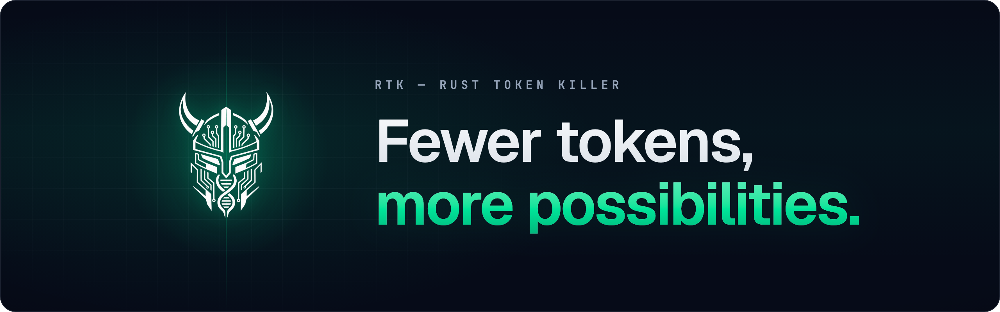
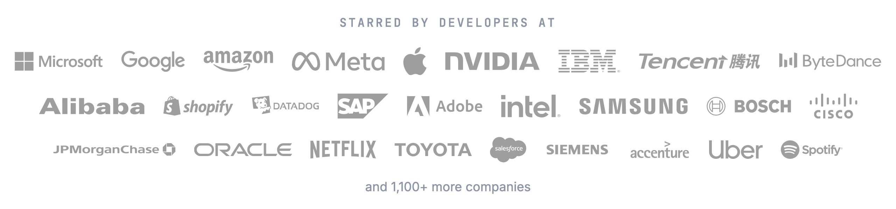
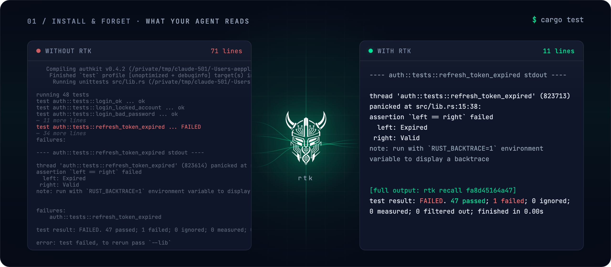
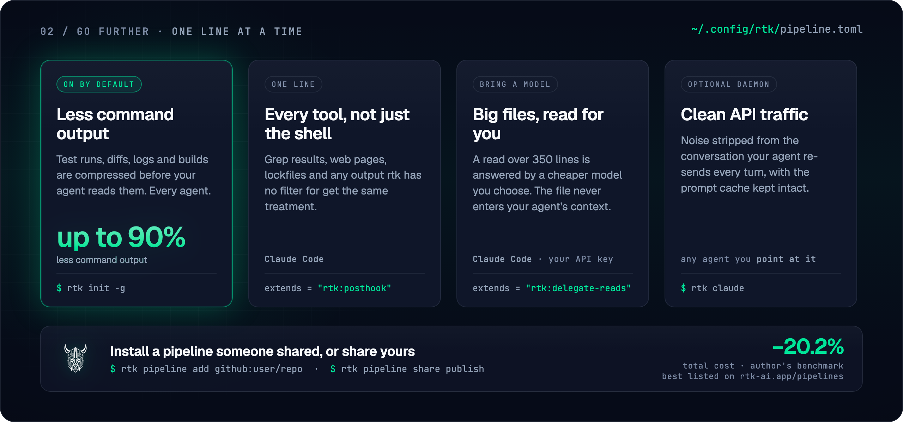
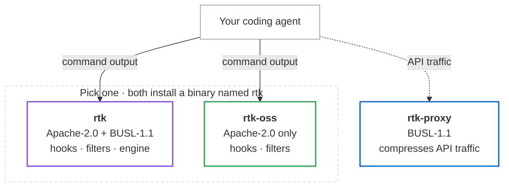

<p align="center">
  
</p>

<p align="center">
  <strong>The cost reduction engine for AI coding agents.</strong>
  <br>
  Install it and forget it, then go as far as you want with pipelines.
</p>

<p align="center">
  <a href="https://github.com/rtk-ai/rtk/actions"></a>
  <a href="https://github.com/rtk-ai/rtk/releases"></a>
  <a href="#editions-and-licence"></a>
  <a href="https://discord.gg/RySmvNF5kF"></a>
  <a href="https://formulae.brew.sh/formula/rtk"></a>
</p>

<p align="center">
 <a href="https://www.star-history.com/rtk-ai/rtk">
  <picture><source media="(prefers-color-scheme: dark)" srcset="https://api.star-history.com/badge?repo=rtk-ai/rtk&type=rank&theme=dark" /><source media="(prefers-color-scheme: light)" srcset="https://api.star-history.com/badge?repo=rtk-ai/rtk&type=rank" /></picture> <picture><source media="(prefers-color-scheme: dark)" srcset="https://api.star-history.com/badge?repo=rtk-ai/rtk&type=trending&theme=dark" /><source media="(prefers-color-scheme: light)" srcset="https://api.star-history.com/badge?repo=rtk-ai/rtk&type=trending" /></picture>
 </a>
</p>

<p align="center">
  
</p>

<p align="center">
  <a href="#install--forget">Install</a> &bull;
  <a href="https://www.rtk-ai.app/pipelines/">Pipelines</a> &bull;
  <a href="https://www.rtk-ai.app/docs/">Docs</a> &bull;
  <a href="https://www.rtk-ai.app">Website</a> &bull;
  <a href="https://pro.rtk-ai.app">RTK Pro</a> &bull;
  <a href="https://discord.gg/RySmvNF5kF">Discord</a>
</p>

<p align="center">
  <a href="README.md">English</a> &bull;
  <a href="README_fr.md">Francais</a> &bull;
  <a href="README_zh.md">中文</a> &bull;
  <a href="README_ja.md">日本語</a> &bull;
  <a href="README_ko.md">한국어</a> &bull;
  <a href="README_es.md">Espanol</a> &bull;
  <a href="README_pt.md">Português</a>
</p>

<br>

**① Install & forget: up to 90% less command output.**
Test runs, diffs, logs and builds are compressed before your agent reads them. 100+ commands, under 25 ms per command, no config, nothing changes in how you work. `rtk gain` shows what you saved.

**② Go further with pipelines, as far as you take it.**
Hand heavy reads to a cheaper model, compress more than bash, clean the API traffic without breaking the prompt cache. One agent-agnostic file: start from a built-in, install one someone shared, or write and share your own.
The community built the bash compressor 85k developers starred. Now it is building pipelines: the best one listed today cuts total cost by 20.2% in its [author's benchmark](https://www.rtk-ai.app/pipelines/).

**Agents across the whole company?** [RTK Pro](https://pro.rtk-ai.app) is the control layer for every AI agent: one gateway for every AI call, costs, secrets and personal data, policies, team catalog, audit. [Discover RTK Pro ↓](#agents-across-the-whole-company-know-what-they-cost-what-they-touch-and-who-ran-what)

<p align="center">
  
</p>

<br>

---

<br>

## Install & forget

**macOS, and Linux with Homebrew**

```bash
brew install rtk
```

**Windows, with winget**

```bash
winget install rtk-ai.rtk
```

**Linux, macOS or WSL, with the install script**

```bash
curl -fsSL https://raw.githubusercontent.com/rtk-ai/rtk/refs/heads/master/install.sh | sh
```

**Then plug it into your agent**

```bash
rtk init -g                      # Claude Code; every other agent: see "Works in your agent"
```

Restart your agent. That's it: when it runs `git status`, RTK runs `rtk git status` and the agent reads a 3-line summary instead of 40 lines. Nothing to learn, nothing to call, and upgrading RTK never changes this.

> Another project named "rtk" exists on crates.io. Check you have this one: `rtk gain` must show the savings dashboard, not "command not found".
>
> Cargo, pre-built binaries, native Windows, WSL and uninstall: **[Installation guide](https://www.rtk-ai.app/docs/getting-started/installation/)** · per-agent setup and `--dry-run`: **[Quick Start](https://www.rtk-ai.app/docs/getting-started/quick-start/)**

<br>

## Measure it: `rtk gain`

Every command RTK touches is counted on your machine. One command shows what it saved, today and since you installed it.

```bash
rtk gain                        # Summary stats
rtk gain --graph                # ASCII graph (last 30 days)
rtk gain --history              # Recent command history
rtk gain --daily                # Day-by-day breakdown
rtk gain --all --format json    # JSON export for dashboards

rtk discover                    # Find missed savings opportunities
rtk discover --all --since 7    # All projects, last 7 days

rtk session                     # Show RTK adoption across recent sessions
```

**What the numbers mean.** The compressor reduces the **command output** your agent reads, which is one part of the input tokens, which are one part of the bill: a 90% cut in command output is not a 90% cut in cost. Token counts are estimated as `bytes / 4`, so the percentages are reliable and the absolute numbers are approximate.

After a week of data, `rtk gain` ends with one line about RTK Pro, at most once a day and only on a terminal. `pro_hint = false` under `[display]` in `config.toml` turns it off.

> Full explanation: [How RTK Savings Work](docs/guide/resources/savings-explained.md) · attribution, the live dashboard and export formats: **[Token Savings Analytics](https://www.rtk-ai.app/docs/analytics/gain/)**

<br>

## Out of the box: the bash compressor

The part 85k developers starred. Built by 200+ contributors, written against real command output, and every filter has to cut at least 20% to ship.

<p align="center">
  
</p>

| Operation | What the agent reads |
|-----------|----------------------|
| `cargo test` / `npm test` / `pytest` / `go test` | Failures only, with their assertion; passing tests collapsed to a count |
| `git status` / `git diff` / `git log` | Compact status, reduced diff context, one line per commit |
| `git add/commit/push` | A confirmation line instead of progress output |
| `ls` / `tree` / `grep` / `rg` | Trees with counts, matches grouped by file, long lines cut |
| `ruff check` / `eslint` / `cargo clippy` | Grouped by rule and file |
| `docker ps` / `kubectl` | Essential fields only |

100+ commands across Git, GitHub CLI, Cargo/Rust, JavaScript (npm, pnpm, vitest, jest, tsc, Next.js, Angular, Playwright, Prisma), Python (ruff, pytest, mypy, pip), Go (go test, golangci-lint), Ruby, .NET, JVM (Gradle, Maven), PHP, Docker, Kubernetes, AWS, Terraform, and the file/search builtins. Every command and its filter: **[What RTK Optimizes](https://www.rtk-ai.app/docs/resources/what-rtk-covers/)**

**Three promises**

- **Never blocks.** If a filter fails, you get the raw output, and the command's exit code is passed through unchanged.
- **Never worse.** RTK never prints more than the command did.
- **Nothing hidden.** Output that is cut says where the full version is, and `rtk bypass` runs any command unfiltered, still tracked in `rtk gain`:

```bash
rtk bypass git log --oneline -20        # full git log, no truncation
rtk bypass npm install express          # raw npm output
```

The hook rewrites shell commands. Built-in tools such as `Read`, `Grep` and `Glob` pass through untouched out of the box; in Claude Code, a pipeline compresses them too (see [Pipelines](#want-to-go-further-pipelines) below).

> **Does RTK break the prompt cache?** No: output is filtered once, before it enters the conversation. [Details](docs/guide/resources/troubleshooting.md#does-rtk-break-claudes-prompt-cache).

<br>

## Want to go further? Pipelines.

Out of the box, RTK compresses command output and stops there. A pipeline is how you ask it for more: one small file that tells RTK what to do with what your agent reads and sends. No file means the compressor above and nothing else; a pipeline adds one thing at a time, and you can take it back out.

<p align="center">
  
</p>

**What people turn on first**

- **Compress everything the agent reads**, not just shell output: grep results, web pages, lockfiles, any output RTK has no filter for (Claude Code).
- **Hand big file reads to a cheaper model** you choose. The file never enters your agent's context (Claude Code, with your API key).
- **Clean the API traffic** your agent re-sends every turn, with the prompt cache kept intact (through the optional proxy, below).
- **Make the agent write less**: terse prose, with code, paths, commands and errors kept in full (every agent).

Each of these is a built-in pipeline, one line to turn on. **[rtk-ai.app/pipelines](https://www.rtk-ai.app/pipelines/)** lists them next to the pipelines the community shares, each with what it saved and how that was measured. Installing one is a single command:

```bash
rtk pipeline add github:user/repo        # check and install a shared pipeline
```

A pipeline can rewrite commands and send content to the models it declares, so read its file before you install it. Written once, a pipeline works in every agent RTK supports, as far as that agent's hooks allow: **[Agent Coverage](https://www.rtk-ai.app/docs/resources/agent-coverage/)** shows what runs where.

> Start here: **[Pipelines](https://www.rtk-ai.app/docs/pipelines/overview/)** · the built-ins, explained: **[Reference Pipelines](https://www.rtk-ai.app/docs/pipelines/reference-pipelines/)** · write and share your own: **[Writing a Pipeline](https://www.rtk-ai.app/docs/pipelines/writing-pipelines/)**, **[Pipeline Commands](https://www.rtk-ai.app/docs/pipelines/commands/)**

### RTK Proxy (optional)

The `rtk-proxy` daemon runs the same pipeline on your agent's **provider-API traffic**: it strips bytes no model ever needed without breaking the prompt cache, and carries the calls your pipeline routes to cheaper models on the credential your agent already sends, so they show up in `rtk gain`. `rtk init -g` offers to set it up; `rtk claude` starts it and launches Claude through it with no configuration at all.

```bash
rtk claude              # start the daemon if needed, then launch Claude through it
rtk llm-proxy status    # is it up
rtk gain                # savings, command filtering and proxy side by side
```

Separate binary, separate licence (BUSL-1.1), its own `rtk-proxy-<target>` archive: `rtk` never links it. Not the same thing as `rtk bypass`, which runs one local command unfiltered.

> Setup and subcommands: **[RTK Proxy](https://www.rtk-ai.app/docs/proxy/overview/)** · what it compresses: **[What the Proxy Compresses](https://www.rtk-ai.app/docs/proxy/compression/)** · settings and endpoints: **[Proxy Configuration](https://www.rtk-ai.app/docs/proxy/configuration/)**

<br>

---

<br>

## Agents across the whole company? Know what they cost, what they touch, and who ran what.

<a href="https://pro.rtk-ai.app">
  
</a>

RTK runs on each developer's machine. **[RTK Pro](https://pro.rtk-ai.app)** connects them into one control layer for the whole company:

- **Gateway.** Every AI call goes through one place, whichever provider each team uses.
- **Cost control.** Spend by team, person and model. Waste found and removed. Budgets that warn, then stop.
- **Shield.** Secrets and personal data masked before any model sees them.
- **Policies.** Risky commands stopped before they run.
- **Team catalog.** Skills, MCP servers and pipelines, assigned per team and project.
- **Audit log.** Who did what, and whether it was allowed.

Nothing changes for the developer. No secret value ever leaves the machine. The CLI stays free and open source.

| **Just you?** | **Your team, or the whole company?** |
|---|---|
| The **Dev** plan: guardrails and analytics for one developer. Your own dashboard of spend per project and per model, the Shield and policies on your machine, nothing to administer. | **Teams**, **Business** and **Enterprise**: the full control layer for every developer, with SSO and the audit log, scaled across the organisation, up to on-premise deployment and a custom SLA. |
| [Plans and what each includes →](https://pro.rtk-ai.app/pricing) | [See what it is worth for your team →](https://pro.rtk-ai.app/pricing) · [Talk to us →](https://pro.rtk-ai.app/contact) |

<br>

---

<br>

## Works in your agent

RTK supports 18 AI coding tools. With a **hook** or **plugin**, `rtk init` installs it and compression is automatic. With a **rules file**, RTK asks the model to prefer `rtk` commands instead.

| Tool | Install | How |
|------|---------|-----|
| **Claude Code** | `rtk init -g` | hook |
| **GitHub Copilot** (VS Code, CLI) | `rtk init -g --copilot` | hook |
| **Cursor** | `rtk init -g --agent cursor` | hook |
| **Gemini CLI** | `rtk init -g --gemini` | hook |
| **Codex** | `rtk init -g --codex` | hook |
| **Mistral Vibe** | `rtk init -g --agent vibe` | hook |
| **Factory Droid** | `rtk init -g --agent droid` | hook |
| **Trae** | `rtk init --agent trae` (or `-g`) | hook |
| **OpenCode** (1.18.29+) | `rtk init -g --opencode` | plugin |
| **OpenClaw** | `openclaw plugins install ./openclaw` | plugin |
| **Pi** / **Oh My Pi** | `rtk init -g --agent pi` / `--agent omp` | plugin |
| **Hermes** | `rtk init --agent hermes` | plugin |
| **Windsurf** | `rtk init -g --agent windsurf` | rules file |
| **Cline / Roo Code** | `rtk init --agent cline` | rules file |
| **Kilo Code** | `rtk init --agent kilocode` | rules file |
| **Google Antigravity** | `rtk init --agent antigravity` (or `-g`) | rules file |
| **Kimi AI** | `rtk init --agent kimi` | rules file |

Per-agent setup, what each hook API allows, override controls: **[Supported Agents](https://www.rtk-ai.app/docs/getting-started/supported-agents/)** · **[Agent Coverage](https://www.rtk-ai.app/docs/resources/agent-coverage/)**

<br>

## Documentation

**[rtk-ai.app/docs](https://www.rtk-ai.app/docs/)** is the full user guide.

| | |
|---|---|
| [Installation](https://www.rtk-ai.app/docs/getting-started/installation/) | every install method, Windows, WSL, uninstall |
| [Quick Start](https://www.rtk-ai.app/docs/getting-started/quick-start/) | per-agent init, `--dry-run`, first savings |
| [Supported Agents](https://www.rtk-ai.app/docs/getting-started/supported-agents/) | setup detail, override controls, degradation |
| [Agent Coverage](https://www.rtk-ai.app/docs/resources/agent-coverage/) | what each agent's hook API lets RTK do |
| [What RTK Optimizes](https://www.rtk-ai.app/docs/resources/what-rtk-covers/) | every command and its filter |
| [Configuration](https://www.rtk-ai.app/docs/getting-started/configuration/) | `config.toml`, env vars, recall recovery |
| [Token Savings Analytics](https://www.rtk-ai.app/docs/analytics/gain/) | `rtk gain` in full |
| [Pipelines](https://www.rtk-ai.app/docs/pipelines/overview/) | the engine: `pipeline.toml`, rules, judges, tasks, sharing |
| [RTK Proxy](https://www.rtk-ai.app/docs/proxy/overview/) | the daemon: setup, what it compresses, settings |
| [Editions and Licensing](https://www.rtk-ai.app/docs/resources/editions/) | what each download contains |
| [Telemetry & Privacy](https://www.rtk-ai.app/docs/resources/telemetry/) | what is collected, how to opt in, your GDPR rights |
| [Troubleshooting](https://www.rtk-ai.app/docs/resources/troubleshooting/) | common issues, prompt-cache questions |

Repository references: [engine/README.md](engine/README.md) · [proxy/README.md](proxy/README.md) · [ARCHITECTURE.md](docs/contributing/ARCHITECTURE.md) · [CONTRIBUTING.md](CONTRIBUTING.md) · [SECURITY.md](SECURITY.md)

RTK collects **no command content and no file contents**. Telemetry is anonymous and **off by default** — it sends nothing until you opt in with explicit consent (GDPR Art. 6 & 7) via `rtk telemetry enable`, and documented in [Telemetry & Privacy](https://www.rtk-ai.app/docs/resources/telemetry/).

<br>

## Editions and licence

RTK ships as three downloads. The two `rtk` editions install a binary with the **same name** — hooks, scripts and agent config work unchanged across both — so they cannot be installed together. Uninstall one before installing the other.

| Download | Licence | Contains |
|---|---|---|
| `rtk-<target>` | Apache-2.0 + BUSL-1.1 | Hook core, every command filter, **and** the pipeline engine |
| `rtk-oss-<target>` | Apache-2.0 only | Hook core and every command filter. No engine. |
| `rtk-proxy-<target>` | BUSL-1.1 | The RTK Proxy daemon. Never bundled with either `rtk`. |

**Production use is free**, engine and daemon included. What the BUSL grant does not cover is offering RTK or a derivative to third parties as a commercial product or service — for that, contact **contact@rtk-ai.app**.

```bash
curl -fsSL .../install.sh | RTK_EDITION=oss sh    # Apache-2.0 edition
brew install rtk-ai/tap/rtk-oss
```

<details>
<summary>Where the licence boundary falls</summary>



The `rtk` CLI is **Apache-2.0** — see [LICENSE](LICENSE). It links one component under a different licence: `rtk-engine` (`engine/`) is **BUSL-1.1**, source-available: see [engine/LICENSE](engine/LICENSE). Its Additional Use Grant permits production use as part of the `rtk` binary, so running `rtk` is covered; using the engine on its own, or inside another product, is not until the Change Date. The `rtk-proxy` daemon (`proxy/`) is **BUSL-1.1** on the same terms and ships as its own archive with its licence alongside — `rtk` never links it.

</details>

> What the Apache-2.0 edition omits and where the licence boundary falls: **[Editions and Licensing](https://www.rtk-ai.app/docs/resources/editions/)**

<br>

---

<br>

## Community

<a href="https://star-history.dera.page/#rtk-ai/rtk&type=date&legend=top-left">
 <picture>
   <source media="(prefers-color-scheme: dark)" srcset="https://star-history.dera.page/svg?repos=rtk-ai/rtk&type=date&theme=dark&legend=top-left" />
   <source media="(prefers-color-scheme: light)" srcset="https://star-history.dera.page/svg?repos=rtk-ai/rtk&type=date&legend=top-left" />
   
 </picture>
</a>

<a href="https://starmapper.bruniaux.com/rtk-ai/rtk">
  <picture>
    <source media="(prefers-color-scheme: dark)" srcset="https://starmapper.bruniaux.com/api/map-image/rtk-ai/rtk?theme=dark" />
    <source media="(prefers-color-scheme: light)" srcset="https://starmapper.bruniaux.com/api/map-image/rtk-ai/rtk?theme=light" />
    
  </picture>
</a>

### Core team

- **Patrick Szymkowiak** — Founder
  [GitHub](https://github.com/pszymkowiak) · [LinkedIn](https://www.linkedin.com/in/patrick-szymkowiak/)
- **Florian Bruniaux** — Core contributor
  [GitHub](https://github.com/FlorianBruniaux) · [LinkedIn](https://www.linkedin.com/in/florian-bruniaux-43408b83/)
- **Adrien Eppling** — Core contributor
  [GitHub](https://github.com/aeppling) · [LinkedIn](https://www.linkedin.com/in/adrien-eppling/)
- **Nicolas Le Cam** — Core contributor
  [Github](https://github.com/kush) · [LinkedIn](https://www.linkedin.com/in/nicolas-le-cam-386387160/)
- **Takayuki Maeda** — Core contributor
  [GitHub](https://github.com/TaKO8Ki) · [LinkedIn](https://www.linkedin.com/in/tako8ki/)

### Contributing

Contributions welcome: a new filter, a fix, or a pipeline you publish with `rtk pipeline share publish`. Open an issue or PR on [GitHub](https://github.com/rtk-ai/rtk) and read [CONTRIBUTING.md](CONTRIBUTING.md) first.

Join the community on [Discord](https://discord.gg/RySmvNF5kF).

### Disclaimer

See [DISCLAIMER.md](DISCLAIMER.md).
